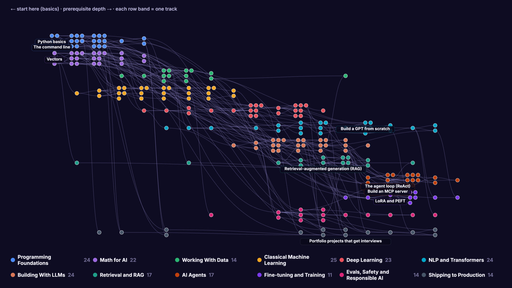
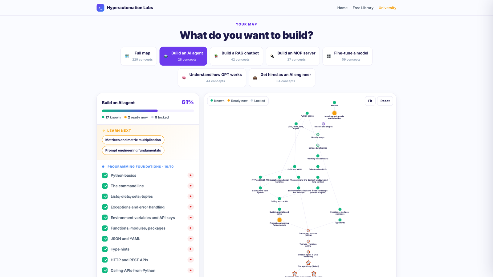
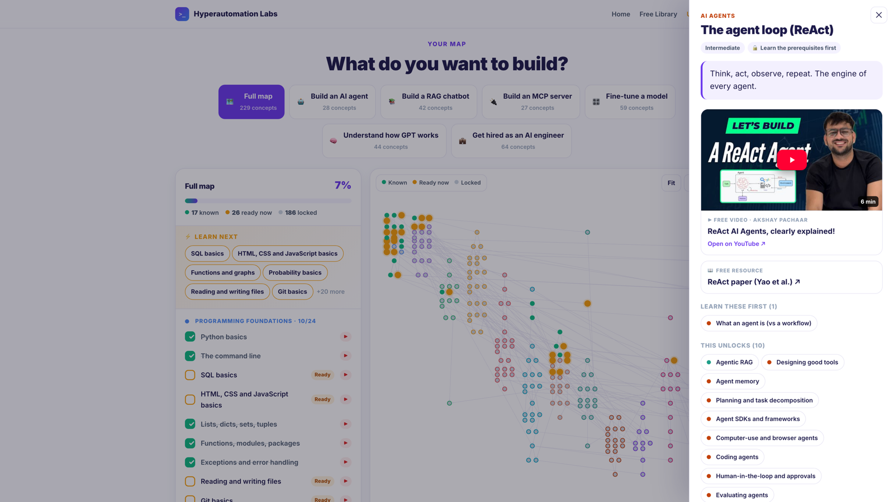

# The AI Engineer Map

**Every concept you need to become an AI engineer, connected by what you must learn first.**
Pick a goal, tick what you already know, and the map shows your exact next step, with one free resource and one free video for every concept.

### 👉 [Open the map](https://hyperautomationlabs.co/university/ai-engineer-map) (free, no signup)



| | |
|---|---|
| **229** concepts | **355** prerequisite links |
| **12** tracks | **226** free videos from 78 channels (86 hours) |
| **6** goal paths | **224 / 224** reading links checked |

## Why a map and not a list?

Every AI roadmap is a list: Python, math, machine learning, transformers, RAG, agents. But learning isn't a line. To understand attention you need dot products, softmax and embeddings; embeddings need vectors and a neural network; and so on. Miss one link and the next video stops making sense.

A list also starts everyone at step one. This map starts where **you** are.

## How it works

1. **Pick a goal.** The map trims itself to what that goal needs.
2. **Tick what you know.** Your progress saves in your browser.
3. **Learn what's glowing.** Orange concepts are ready: you have every prerequisite. Each one has why it matters, a free video, a free reading, what it needs and what it unlocks.




## The six goal paths

| Goal | Concepts | Free video | Math concepts |
|---|---:|---:|---:|
| 🤖 Build an AI agent | 28 | 13.7 h | 3 |
| 📚 Build a RAG chatbot | 42 | 16.6 h | 9 |
| 🔌 Build an MCP server | 27 | 15.5 h | 3 |
| 🎛️ Fine-tune a model | 59 | 22.1 h | 12 |
| 🧠 Understand how GPT works | 44 | 15.9 h | 13 |
| 💼 Get hired as an AI engineer | 64 | 26.8 h | 9 |

The single concept that sits underneath 78% of the map (179 of 229) is **vectors**. Start there.

## The 12 tracks

Programming Foundations (24) · Math for AI (22) · Working With Data (14) · Classical Machine Learning (25) · Deep Learning (23) · NLP and Transformers (24) · Building With LLMs (24) · Retrieval and RAG (17) · AI Agents (17) · Fine-tuning and Training (11) · Evals, Safety and Responsible AI (14) · Shipping to Production (14)

## Repo layout

```
data/tracks/*.yaml   one file per track, one block per concept (the source of truth)
data/videos.json     one free YouTube video per concept (hand-checked)
data/graph.json      generated: nodes + edges + depth
scripts/build.mjs    validates the graph (unknown prerequisites, cycles) → graph.json
scripts/check-links.mjs  checks every reading link
scripts/build-site.mjs   builds the single-file web app → dist/index.html
web/template.html    the map page
```

A concept looks like this:

```yaml
- id: vectors
  title: Vectors
  level: 1                 # 1 beginner · 2 intermediate · 3 advanced
  requires: []             # ids of concepts you need first
  why: Every word, image and user becomes a vector inside a model.
  learn: { title: "3Blue1Brown: Essence of Linear Algebra", url: "https://www.3blue1brown.com/topics/linear-algebra" }
```

## Contributing

Found a better free video, a broken link, a wrong prerequisite, or a concept we missed? Pull requests are welcome.

1. Edit the concept in `data/tracks/` (or its video in `data/videos.json`).
2. Run `npm install && npm run check` (it fails on unknown prerequisites or cycles).
3. Open a pull request saying why the change helps a learner.

Rules of thumb: resources must be **free**; prefer official docs and teachers with a track record; one resource and one video per concept; keep `why` to one plain sentence.

## Run it locally

```bash
npm install
npm run build        # → dist/index.html (a single self-contained file)
open dist/index.html
```

## License

Code: [MIT](LICENSE). Map data (`data/`): [CC BY 4.0](data/LICENSE). Videos and readings belong to their creators; the map only links to them.

Made by [Hyperautomation Labs](https://hyperautomationlabs.co) · [Hyperautomation Labs University](https://hyperautomationlabs.co/university)
